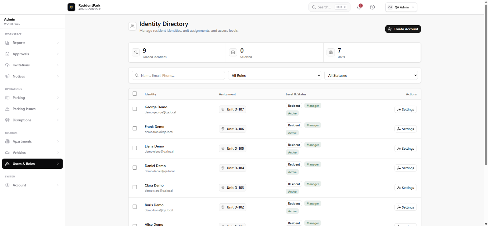
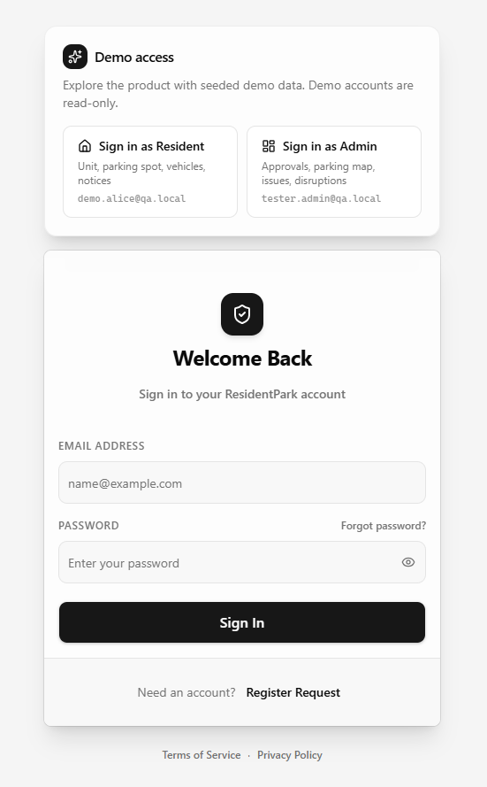

# ResidentPark OS

[](https://github.com/Darhaal/ResidentPark-OS-Demo/actions/workflows/ci.yml)

A residential parking and property-administration platform built with Next.js and
Supabase. It manages residents, apartments, vehicles, parking assignments and
relocations, approvals, construction disruptions, parking issues, notices, reports,
invitations, and audit history — with distinct resident and admin/superadmin
experiences.

## Live demo

**[parking-demo-ecru.vercel.app](https://parking-demo-ecru.vercel.app)** — a seeded, self-contained demo of the full product.

No sign-up and no password: on the sign-in page click **Sign in as Admin** or **Sign in as
Resident**. A thin *Demo* bar at the top shows the current role and switches between the
two in one click.

The admin account manages approvals, parking, vehicles, issues, disruptions, notices, and
reports; the resident owns a unit with an assigned spot and a vehicle awaiting approval.

Demo accounts are **read-only**: you can open every page of both roles, but changes are rejected with
*"Demo mode: changes are disabled."*, so the shared demo looks the same for every visitor.
The rule lives in Postgres, not only in the UI — a statement-level trigger on every table
rejects writes from the listed demo accounts whether they come through the app, PostgREST,
or an RPC ([`20261126000000_demo_readonly_accounts.sql`](supabase/migrations/20261126000000_demo_readonly_accounts.sql)).

## Product preview



*Admin console — Identity Directory: residents, unit assignments, roles, and account status
(seeded demo data).*

<p align="center">
  
</p>

## Engineering highlights

- **Defense-in-depth authorization** — server-side guards (`src/lib/auth.ts`) enforce
  authentication, role, and account-status checks, backed by Postgres Row-Level Security
  and RPC self-checks so the database enforces the same rules as the application.
- **Transactional workflows** — sensitive multi-step state changes are delegated to
  `tx_*` Postgres RPCs, keeping operations atomic and auditable.
- **Multi-role domain model** — distinct Resident / Admin / Superadmin flows with account
  lifecycle states (pending, approved, suspended, rejected).
- **Automated quality gates** — unit, database-authorization, security-posture, and browser
  E2E suites run in GitHub Actions CI alongside typecheck, lint, and production build.

## Status & confidentiality

This repository is a **curated review build** shared for evaluation. It runs the core
product end to end, but it is intentionally a limited demo rather than the full
production system.

Withheld under confidentiality and **not** included in this copy:

- production deployment configuration and any live environment values;
- live production data and real user credentials;
- internal engineering, planning, and QA documentation;
- proprietary modules and later-stage development.

Everything here has been sanitized for public review: production data, live configuration,
and proprietary components have been removed. Live infrastructure details and anything
marked confidential cannot be disclosed here.

## Tech stack

- **Next.js 16** (App Router) + **React 19** + **TypeScript** (strict)
- **Tailwind CSS 4** with local shadcn-style UI primitives
- **Supabase** — Auth, Postgres, Row-Level Security, and SQL RPC functions
- **Vitest** (unit + jsdom component tests) and **Playwright** (E2E)

## Architecture at a glance

- **Server components** load typed initial data for each route.
- **Client components** own interactive state (tables, filters, drawers, dialogs).
- **Server Actions** perform mutations behind centralized authorization guards
  (`src/lib/auth.ts`).
- **Services** (`src/services`) delegate sensitive state changes to transactional
  `tx_*` Postgres RPCs, so multi-step mutations are atomic and auditable.
- **RLS policies and RPC self-checks enforce the same rules as the application** —
  UI visibility is never the security boundary. Account status (approved /
  pending / suspended / rejected) gates access at both layers.
- Routes, roles, statuses, limits, and option sets live in `src/config`;
  user-visible strings live in `src/localization/en`.

```
src/
  app/            Routes (resident + /admin), route handlers, error/loading boundaries
  components/     Shared UI, layout chrome, resident + admin building blocks
  services/       Domain services that call transactional RPCs
  actions/        Guarded Next.js Server Actions
  lib/            Auth guards, Supabase clients, errors, rate limiting, logging
  config/         Routes, roles, domain enums, limits
  localization/   English UI copy
  test/db/        Database authorization / RLS / RPC test suites
supabase/         baseline.sql, applied migrations, and rebuild notes
scripts/          Seed, schema-export, and verification tooling
e2e/              Playwright specs
```

## Getting started

Prerequisites: Node 20+, npm, and a Supabase project (or the Supabase CLI for a
local stack).

```bash
npm install
cp .env.example .env.local   # then fill in your Supabase values
npm run dev                  # http://localhost:3000
```

Environment variables are documented in [`.env.example`](.env.example). The only
values required to build and run the app are the Supabase URL, anon key, and
service-role key. **`SUPABASE_SERVICE_ROLE_KEY` is server-only** — never prefix it
with `NEXT_PUBLIC_` or reference it in browser code.

### Database

The schema is a clean-rebuild snapshot plus a numbered, append-only migration
archive:

- `supabase/baseline/baseline.sql` — the clean-rebuild snapshot.
- `supabase/applied/0001…` — post-baseline migrations, applied in order.
- `supabase/pending/` — unapplied work (currently empty).

Apply the baseline and migrations to your Supabase project via the Supabase CLI
(or `scripts/apply-sql.mjs` for a single reviewed file), then optionally seed demo
data with `npm run seed:demo` (set `SEED_PASSWORD` first).

## Scripts

```bash
npm run dev              # start the dev server
npm run build            # production build
npm run check            # typecheck + lint + unit tests + build
npm run typecheck        # tsc --noEmit
npm run lint             # eslint
npm run test:run         # unit + component tests (Vitest)
npm run test:db          # database authorization tests (needs a local Supabase)
npm run test:e2e         # Playwright E2E (needs a running app + seeded DB)
npm run verify:security  # static security-posture checks
npm run seed:demo        # seed demo accounts/data (local/demo only)
```

## Testing

- **Unit + component** (`npm run test:run`) run with no external dependencies.
- **Database authorization** (`npm run test:db`) load the schema into a
  **disposable** Supabase/Postgres and exercise RLS and every privileged RPC.
  Never point them at a production project.
- **E2E** (`npm run test:e2e`) drive the app end-to-end against a seeded local
  stack.

## License

Provided for review purposes.
